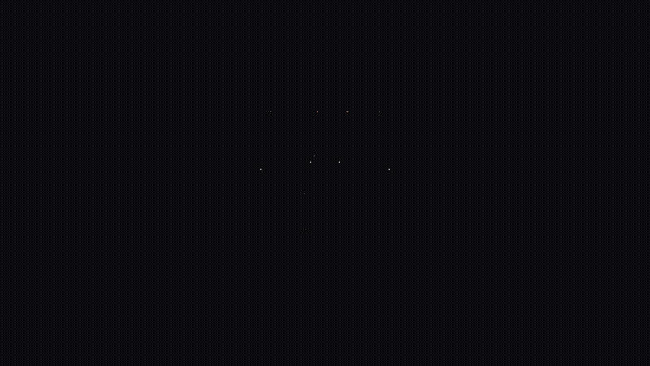
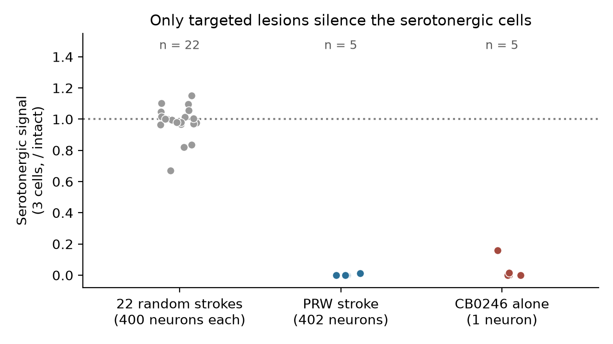
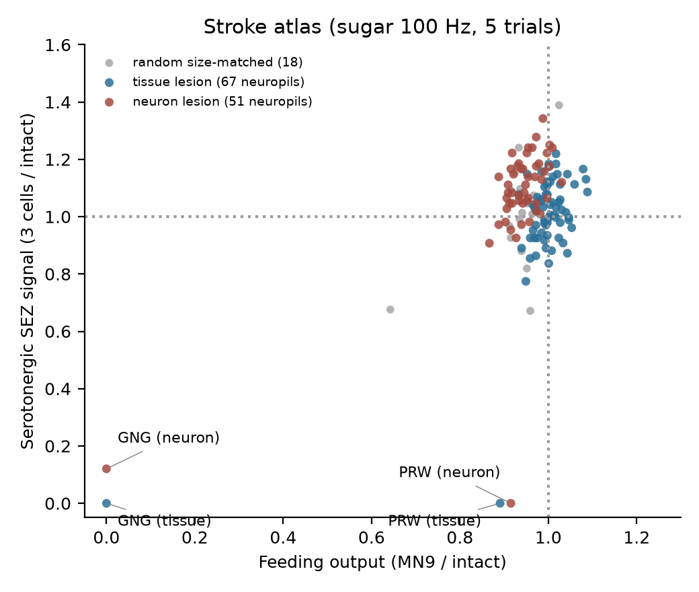
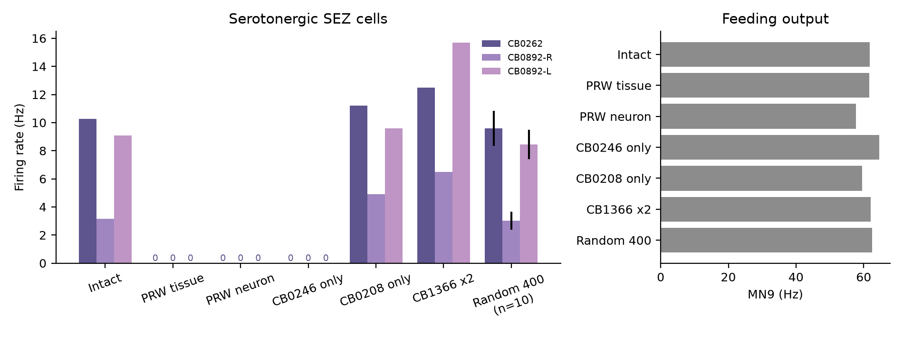
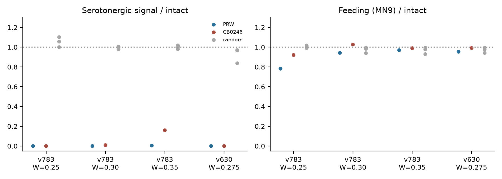
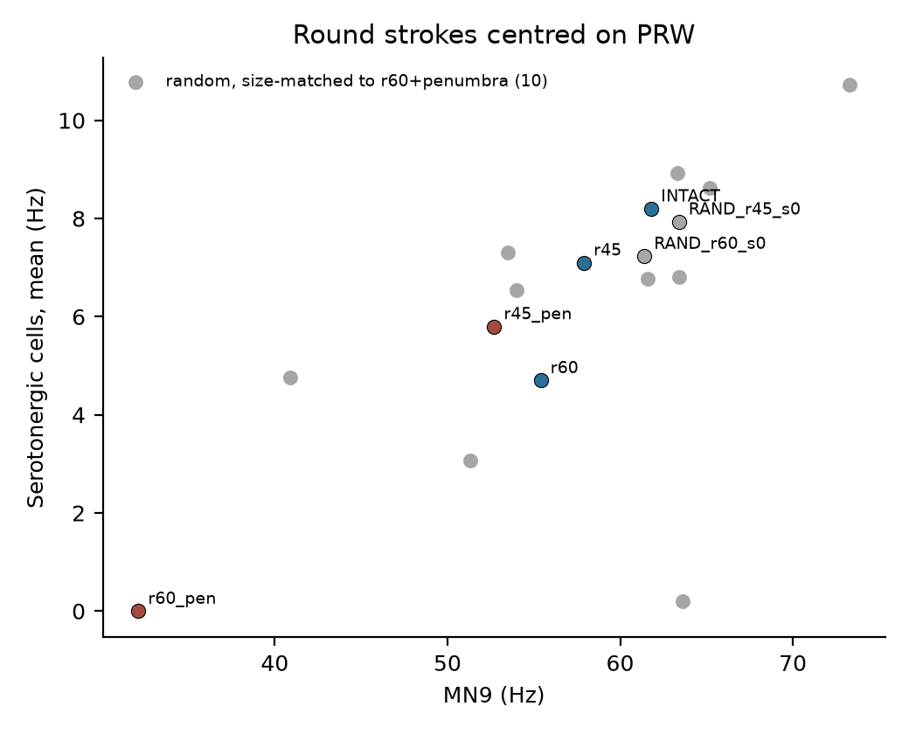
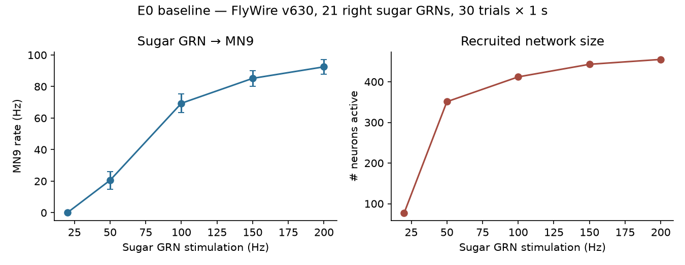
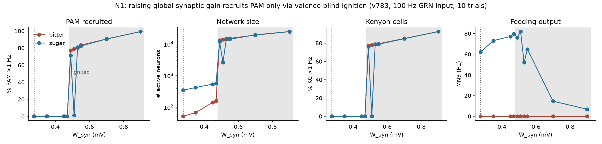

# StrokeSim

**A single neuron links stroke to serotonin loss in a whole-brain fruit fly model.**

An open research project by Udit Akhouri (Lossfunk). We put simulated strokes
into a full-brain model of *Drosophila*, built from the FlyWire wiring diagram, and ask which damage
changes what the brain does. All code, small result tables and figures are here. Everything can be
re-run on a laptop.

<p align="center">
  <a href="docs/media/FruitFlyBrain.mp4"></a>
  <br><sub>10 s explainer. Click for the MP4.</sub>
</p>

## The question

After a stroke, about one in three people develop depression. Human lesion studies suggest that it
depends less on *where* the stroke lands than on *which connections* it cuts. Human brain maps are
too coarse to test that at the level of single cells. The fly brain is the first adult brain mapped
synapse by synapse (about 139,000 neurons), and it has a published whole-brain spiking model
([Shiu et al. 2024](https://doi.org/10.1038/s41586-024-07763-9)). So we can stroke it in silico,
cell by cell, and watch.

## What we did

- **Model.** The Shiu et al. leaky integrate-and-fire network on the FlyWire connectome (v783; v630
  for replication), in Brian2.
- **Input.** Sugar taste neurons driven at 100 Hz.
- **Readouts.** Feeding: the proboscis motor neuron MN9. Mood proxy: three serotonergic cells in the
  subesophageal zone (CB0262 and two CB0892).
- **Strokes.** Silence every neuron in one brain region (51 regions), remove every synapse in a region
  (67 regions), round focal strokes with a penumbra, and size-matched random strokes as controls.

## Findings

<p align="center"></p>

1. **Feeding is hard to break.** MN9 survives lesions of 49 of 51 regions. Only the gnathal ganglion
   (GNG), the taste hub, is a single point of failure.
2. **A stroke on the prow (PRW) silences serotonin but spares feeding.** All three serotonin cells go
   to 0 Hz while MN9 stays near normal. **0 of 22** random strokes of the same size do this.
3. **One relay neuron carries it.** Silencing just CB0246 (FlyWire `720575940632602532`), a
   cholinergic cell with 169 synapses onto the serotonin cells, does the same: serotonin 0 Hz, MN9
   64.6 Hz. Round strokes centred on PRW that miss CB0246 (about 100 µm away) leave serotonin firing.
4. **It replicates.** PRW silences serotonin in 5 of 5 model settings (two connectome versions,
   synaptic weight 0.25–0.35 mV). CB0246 alone does it in 4 of 5, and cuts it by 80–93% in the fifth.
5. **It survives a stress test.** Knocking out each of the 402 PRW neurons one by one finds CB0246
   as the top hit. The result holds under weight noise and in a second, independent connectome (the
   Janelia male CNS), where silencing both CB0246 cells removes the serotonin response. See
   [the stress test](#follow-up-stress-test-of-the-cb0246-result).

**Caveat on "feeding spared":** MN9 lifts the proboscis. The pharyngeal pump motor neurons, which
swallow, drop 30–55% when CB0246 is silenced and to 0 after the PRW stroke. So the stroke spares
reaching for food, not all of feeding.

**Takeaway:** what a stroke does depends on which cell it cuts, not just where it lands. This is the
cellular version of "disconnection, not location" from human lesion network mapping.

**Testable prediction:** silencing CB0246 in a real fly should abolish sugar-evoked activity in
CB0262/CB0892 while proboscis extension stays normal.

### Figures

| | |
|---|---|
| <br>**Stroke atlas.** Every region lesion, feeding vs serotonin. Only GNG and PRW leave the cloud. | <br>**The bottleneck.** CB0246 alone silences the three serotonin cells; neighbouring cells don't. Feeding is unchanged. |
| <br>**Replication** across connectome versions and synaptic weights. | <br>**Round strokes on PRW.** Only the largest (r60 + penumbra) silences serotonin, and so does 1 of 10 size-matched random strokes. Round strokes alone are not location-specific. |
| <br>**Model check.** Sugar dose drives MN9 as in Shiu et al. | <br>**Model audit.** Reward dopamine (PAM) cells join only when the whole brain ignites. |

Supplementary: [SEZ monoamine readout and PAM membrane potential](docs/figures/figS1_sez_pamvm.png).

Readout IDs (v783): MN9 `720575940660219265`; 5-HT cells `720575940636895406`,
`720575940631179831`, `720575940628676457`.

## Status

Preprint in preparation. Results are from a simulation and have not been tested in flies yet.
Feedback, replication attempts and wet-lab collaborators are welcome: open an issue.

The Python package is still called `ffsim` (the project's working name).

## Quick start

Requires Python 3.11 and [uv](https://github.com/astral-sh/uv).

```bash
git clone https://github.com/UditAkhourii/StrokeSim.git && cd StrokeSim
uv venv --python 3.11 .venv
uv pip install --python .venv/bin/python -r requirements.txt
scripts/download_data.sh          # ~ several GB; idempotent
.venv/bin/python experiments/e0_baseline.py --rates 100 --n-run 2   # smoke test
```

Notes on dependencies:

- **`numpy<2.4`** is required. Brian2 2.9.0 calls `ndarray.ptp`, which numpy 2.4 removed.
  `requirements.txt` pins the exact versions used (numpy 2.3.5).
- **Cython** is needed for Brian2's `cython` code-generation target. The first run per connectome
  version compiles the network (about 15 min); later runs reuse the cache. On macOS, if clang cannot
  find `<cstdlib>`, Brian2 silently falls back to the slower numpy target; set
  `CPLUS_INCLUDE_PATH=$(xcrun --show-sdk-path)/usr/include/c++/v1`.

All scripts are run from the repo root and resolve paths relative to it.

## Data

`scripts/download_data.sh` fetches everything into `external/` and `data/` (both git-ignored):

| What | Source | Destination |
|---|---|---|
| Shiu et al. model + v630/v783 connectivity, `Completeness_783.csv` | `git clone https://github.com/philshiu/Drosophila_brain_model` | `external/Drosophila_brain_model/` |
| FlyWire neuron annotations (Schlegel et al. 2024) | [raw GitHub TSV](https://raw.githubusercontent.com/flyconnectome/flywire_annotations/main/supplemental_files/Supplemental_file1_neuron_annotations.tsv) | `data/annotations/neuron_annotations.tsv` |
| Per-neuron neuropil synapse counts, v783 | [Zenodo 10676866](https://zenodo.org/records/10676866) `per_neuron_neuropil_count_{pre,post}_783.feather` | `data/neuropil/`, `data/flywire783/` |
| Proofread connections, v783 | Zenodo 10676866 `proofread_connections_783.feather` | `data/flywire783/` |

`scripts/build_neuropil_table.py` then builds `data/neuropil/neuron_neuropil_783.parquet`: pre and
post counts concatenated, summed per `flywire_id × neuropil`, restricted to the v783 neurons in
`Completeness_783.csv`, with `frac = count / total`. A neuron belongs to a neuropil lesion when
`frac ≥ 0.5`.

## Repository layout

```
ffsim/            library
  sim.py          Shiu LIF runner; Model builds once and store()/restore()s between trials
  lesion.py       neuropil / sphere / random lesion sets, neuropil centroids
  lesions.py      neuropil fractions + lesion sets used by E2
  readouts.py     readout panels from FlyWire annotations (PAM, PPL, MBON, SEZ)
experiments/      one script per experiment (see table)
scripts/          data download + derived-table builder
docs/             README figures and the explainer video
results_summary/  small CSVs behind the paper's numbers (full outputs go to results/, ignored)
```

## Experiments

| Script | Paper section | Output |
|---|---|---|
| `e0_baseline.py`, `e0_plot.py` | Methods: model validation (Shiu sugar → MN9, v630) | `results/e0/` |
| `e1_reward_readout.py` | Model audit: PAM/PPL/MBON panel, sugar vs bitter | `results/e1/`, `results/e1_v783/` |
| `e1b_readouts.py`, `e1b_analyze.py` | Model audit: SEZ monoaminergic readout, PAM Vm; defines `sez_da_ids.csv` | `results/e1b/` |
| `e1b_odor_probe.py` | Model audit: olfactory all-or-none ignition | `results/e1b_odor/` |
| `n1_wsyn_tradeoff.py`, `n1_plot.py` | Model audit: W_syn sweep, PAM only via ignition (Fig. 3) | `results/n1/` |
| `a1_stroke_atlas.py` | Finding 1/2: single-neuropil neuron-lesion atlas | `results/a1/` |
| `a1b_random_null.py` | Finding 2: 10 random 400-neuron lesions | `results/a1b/` |
| `e2_lesion_atlas.py`, `e2_analyze.py`, `stroke_analysis.py` | Finding 1/2: tissue + neuron lesion atlas, random size controls, confirmation | `results/e2/`, `results/e2_confirm/` |
| `a2_sphere_lesions.py` | Finding 2: spherical focal strokes with penumbra | `results/a2/` |
| `a3_cb0246_bottleneck.py` | Finding 3: CB0246 single-neuron silencing | `results/a3/` |
| `a5r_replication.py` | Finding 3: v630 + W_syn replication; round-stroke null | `results/replication/` |
| `a4_pruning.py` | Exploratory (synaptic pruning), not in the paper | `results/a4/` |
| `paper_figures.py` | Figures 3–6 (needs full `results/`) | given dir |
| `readme_figures.py` | Headline figure, from `results_summary/` only | `docs/figures/` |

Exact commands, in order, are in [REPRODUCE.md](REPRODUCE.md). `results_summary/` holds the small
CSVs that back the numbers above, including `a1b_random400_null.csv` (MN9 and 5-HT rates per random
seed).

## Follow-up: stress test of the CB0246 result

Scripts `s3*`, `k1` to `k6b` re-test Findings 2 and 3. Unless noted: v783, default W_syn, sugar GRNs at
100 Hz; "serotonin cells" = all 6 immuno-serotonergic SEZ cells (CB0262, CB0212, CB0892; L and R),
which the male CNS annotators label as the sugar-SELs of Yao and Scott (2022). Summaries are in
`results_summary/` (file prefix = script).

| Script | Test | Result |
|---|---|---|
| `s3_dissect_roundnull.py`, `s3b_seed3_causal.py` | Round-stroke null seed 3 (serotonin 0.3 Hz) | Only seed that hits CB0246 (penumbra); random-lesion count is 1/22 |
| `k1_knockout_screen.py` | Silence each of the 402 PRW neurons | 3 confirmed hits: CB0246 L (0%), CB0883 L (8%), CB0559 R (35%) |
| `k2_bilateral.py` | CB0246 twin (49.86% in PRW, outside the 50% lesion) | Twin alone leaves 23 to 33% |
| `k3_bilateral_sugar.py` | The 21 sugar GRNs are all left; add 21 type-matched right GRNs | CB0246 L still leaves 2% |
| `k4_robust_mirror.py`, `k4b_mirror_all_right.py` | Weight noise (lognormal, 10 seeds); right-only input | CB0246 L leaves 1 to 10% in 10/10; with right input both twins leave 52% |
| `k5_controls.py` | PRW cutoff 30 to 70%; pairwise chain knockouts; 200 round strokes | Serotonin loss at every cutoff; 4/200 strokes hit the rule (serotonin < 25%, positioning > 85%), all 4 hit the chain, 0/192 that miss it |
| `k6_malecns.py`, `k6b_malecns_calibrated.py` | Same lesions in the Janelia male CNS | Both CB0246 silenced: 0%; single twins 22 to 45% (right stronger) |
| `p1_static_paths.py`, `q5_activity_map.py` | Can wiring (± one intact run) predict the 402-neuron knockout screen? | CB0246 ranks 1st (direct) / 3rd (excitatory ≤3-hop paths) of 402 PRW neurons. Only 21/402 PRW neurons fire under sugar; all 5 knockouts that cut 5-HT >30% are among them and in the top 10 of both scores. Among the 21 active, Spearman vs effect: static paths 0.70, activity-weighted paths 0.81. Sign-blind paths rank an inhibitory CB1366 first (its knockout raises 5-HT 35%) |
| `q1_brainwide.py` | Which neurons change when CB0246 is silenced (saved rates, no new sim) | 48 of ~370 active neurons change (vs 2–3 for CB0208 / CB1366 knockouts): all 6 5-HT cells, 10 swallowing motor neurons (MN10, MNx01, CB0700, CB0708; −40–70%), ~30 SEZ interneurons. MN9 unchanged |
| `d1_dissociation.py` | Can the serotonin loss be separated from the swallowing loss? Cut edge sets instead of whole neurons (pre-registered, 20 trials) | Half of a double dissociation. Cutting only CB0246's 6 edges onto the serotonin cells leaves serotonin at 7% with swallowing at 92% (both twins: 0% and 98%); so the serotonin loss is not a by-product of motor shutdown. The converse has no match: cutting CB0246's other 323 edges takes swallowing to 43% but serotonin to 29%, and silencing the 5 module neurons with the most synapses onto pump MNs takes swallowing to 5% and serotonin to 19%. Removing the serotonin cells' output leaves swallowing at 96%, so they are not upstream of the pump. MN9 within 3% of intact everywhere |

Two readout notes. MN9 drives rostrum lifting only (Schwarz et al. 2017); the pharyngeal pump motor
neurons (MN10, MNx01, CB0700, CB0708) drop 30 to 55% when CB0246 L is silenced and to 0% after the PRW
lesion, while proboscis-positioning motor neurons are unchanged. The male CNS model is built by
`scripts/build_malecns_model.py` (traced bodies, edges with at least 2 synapses, 15.3M edges) and is
active only above about 0.6x the default W_syn, with broader activity than the FlyWire model.

## Runtime and memory

- About 3 GB RAM per simulation process. On an 8 GB machine run one or two at a time.
- About 5 s per 1 s simulated trial after compilation (Apple-silicon laptop).
- First compile about 15 min per connectome version (v630, v783).

## Limitations

- The Shiu model is a point-neuron LIF network with connectome weights and uniform parameters. It has no
  neuromodulation, plasticity, gap junctions or glia, and neurotransmitter signs are predicted.
- "Stroke" means silencing neurons (outgoing weights set to 0) or deleting synapses. There is no
  ischaemic cascade, no recovery and no rewiring.
- "Serotonergic" is an annotation-level label. The model does not simulate 5-HT release.
- Rates are averaged over 10–30 Poisson trials. Effects near threshold depend on W_syn, so we report a
  W_syn sweep.
- Results are for sugar GRN input only.

## Citation

See [CITATION.cff](CITATION.cff). Please also cite Shiu et al. 2024 and the FlyWire papers below.

## License

MIT, see [LICENSE](LICENSE). External data keep their own licenses.

## Acknowledgements

- Shiu, P. K. et al. *A Drosophila computational brain model reveals sensorimotor processing.* Nature (2024). Model code: https://github.com/philshiu/Drosophila_brain_model
- Dorkenwald, S. et al. *Neuronal wiring diagram of an adult brain.* Nature (2024), and the FlyWire Consortium.
- Schlegel, P. et al. *Whole-brain annotation and multi-connectome cell typing of Drosophila.* Nature (2024). Annotations: https://github.com/flyconnectome/flywire_annotations
