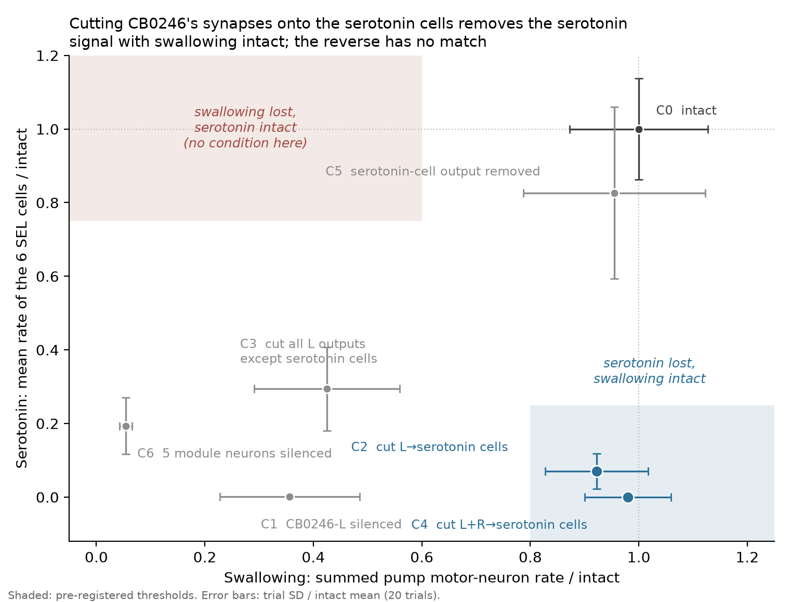

# Experiment D1 — Can serotonin be separated from swallowing?

Project: StrokeSim (`~/Projects/ffsim`, public at github.com/UditAkhourii/StrokeSim)
Pre-registered 2026-10-27 · run 2026-10-27 · `experiments/d1_dissociation.py`
Verdict: **single dissociation, not double.**

## 1. Question

Silencing the relay neuron CB0246 removes the sugar-evoked serotonin (5-HT) response. But Q1
(`experiments/q1_brainwide.py`) showed it also knocks down a whole feeding module: all 6 5-HT
cells to zero, 10 pharyngeal pump (swallowing) motor neurons down 40–70%, about 30 SEZ
interneurons down, MN9 (proboscis lift) unchanged.

Reviewer objection (Sushrut Thorat): the effect may be on the eating *machinery*, not on a
serotonin or value signal. D1 asks whether the model can tell these apart — can the 5-HT signal
be removed without hitting swallowing, and swallowing without hitting 5-HT?

The test instrument is edge cuts rather than whole-neuron knockouts: `Model.run(w_scale=...)`
takes a per-connection multiplier aligned to the rows of `Connectivity_783.parquet`, so a chosen
set of synapses can be zeroed while the presynaptic neuron keeps firing and keeps driving
everything else.

## 2. Methods

- **Model:** Shiu et al. 2024 LIF, FlyWire v783, default W_syn, Brian2 2.9.0 (cython).
- **Runner:** `ffsim.sim.Model` — network built once, `store`/`restore` between trials.
- **Input:** the 20 left sugar GRNs (`NEU_SUGAR` filtered to the v783 completeness index) at
  100 Hz Poisson, 1 s per trial.
- **Trials:** 20 per condition, one simulation process (~3 GB). Build plus 7 conditions ≈ 14 min.
- **5-HT readout:** mean rate of the 6 Yao & Scott 2022 immuno-serotonergic SEL cells
  (CB0262, CB0892, CB0212; L and R). The paper's 3-cell readout is reported alongside.
- **Swallowing readout:** summed rate of the 10 neurons with `cell_type` in
  {MN10, MNx01, CB0700, CB0708}.
- **Positioning readout:** MN9, `720575940660219265`.
- **Module:** the 48 neurons in `results_summary/q1_brainwide_changed.csv` with knockout CB0246.
  A neuron counts as changed under the Q1 rule: |Δ| ≥ 50% of the larger rate, |Δ| ≥ 2 Hz, |z| ≥ 3.
- Every readout is normalised to C0. Error bars and SDs are across the 20 trials.

### Conditions

| ID | Manipulation | Edges cut / cells silenced |
|---|---|---|
| C0 | intact | — |
| C1 | CB0246 L silenced (full knockout) | all 329 outputs |
| C2 | cut CB0246 L → SEL6 synapses only | 6 edges |
| C3 | cut every CB0246 L output **except** onto SEL6 | 323 edges |
| C4 | C2 for both CB0246 L and R | 12 edges |
| C5 | silence all 6 SEL cells | 6 cells |
| C6 | silence the 5 non-5-HT module neurons with the most synapses onto pump MNs | 5 cells |

C6's set was fixed by the pre-registered rule before running: `720575940643867296` (CB4058, GABA,
2,245 synapses onto pump MNs), `720575940625045180` and `720575940625874992` (CB0910, 1,340 /
1,318), `720575940628598121` and `720575940634645600` (CB4055, 1,107 / 1,070).

## 3. Results

Normalised to C0:

| Cond | Manipulation | 5-HT (SEL6) | 5-HT (paper 3) | Pump | MN9 | Module-48 changed | Brain-wide changed | Active |
|---|---|---|---|---|---|---|---|---|
| C0 | intact | 1.000 | 1.000 | 1.000 | 1.000 | 0 | 0 | 1.000 |
| C1 | CB0246 L silenced | 0.001 | 0.002 | 0.357 | 1.023 | 48 / 48 | 55 | 0.973 |
| C2 | cut L → SEL6 | 0.070 | 0.078 | 0.922 | 1.029 | 5 / 48 | 5 | 0.992 |
| C3 | cut all other L outputs | 0.294 | 0.250 | 0.425 | 1.026 | 48 / 48 | 53 | 0.976 |
| C4 | cut L+R → SEL6 | 0.000 | 0.000 | 0.980 | 1.031 | 5 / 48 | 5 | 0.973 |
| C5 | SEL6 output removed | 0.827 | 0.797 | 0.955 | 1.037 | 0 / 43 | 0 | 0.984 |
| C6 | 5 module neurons silenced | 0.194 | 0.180 | 0.054 | 1.016 | 42 / 43 | 49 | 0.992 |

Absolute, mean ± SD over 20 trials:

| Cond | SEL6 mean (Hz) | Pump sum (Hz) | MN9 (Hz) |
|---|---|---|---|
| C0 | 7.36 ± 1.02 | 456.7 ± 58.3 | 60.7 ± 5.1 |
| C1 | 0.01 ± 0.04 | 162.8 ± 59.0 | 62.1 ± 3.9 |
| C2 | 0.52 ± 0.35 | 421.1 ± 43.3 | 62.4 ± 4.9 |
| C3 | 2.17 ± 0.84 | 193.9 ± 61.3 | 62.2 ± 3.6 |
| C4 | 0.00 ± 0.00 | 447.4 ± 36.3 | 62.6 ± 6.0 |
| C5 | 6.08 ± 1.72 | 436.1 ± 76.4 | 62.9 ± 4.9 |
| C6 | 1.43 ± 0.57 | 24.8 ± 5.1 | 61.6 ± 4.2 |

Module-48 denominators are 43 for C5 and C6 because silenced cells are excluded from the
changed-neuron test, as in `q1_brainwide.py`.

## 4. Verdict against the pre-registered decision rules

**The first half holds.** C2 and C4 satisfy 5-HT < 0.25 with pump > 0.8 — C4 removes the signal
completely (0.000) with swallowing at 0.980 and MN9 at 1.031. The brain-wide footprint shrinks
from 55 changed neurons in C1 to 5 in C2 and C4. Cutting 6 of CB0246 L's 329 output edges
therefore removes the serotonin response while swallowing and proboscis lift stay intact: the
serotonin loss is **not** a by-product of the feeding module shutting down. This is the direction
the motor-vs-value objection turns on.

**The second half fails.** Neither available test reaches 5-HT > 0.75 with pump < 0.6:
C3 gives pump 0.425 but 5-HT 0.294, and C6 gives pump 0.054 but 5-HT 0.194. Every manipulation
that removes swallowing also removes most of the serotonin signal. The decision rule for a double
dissociation requires both halves, so the rule is not met.

**The narrowing clause is ruled out.** C5 leaves swallowing at 0.955, so the 5-HT cells are not
upstream of the pump. The claim does **not** narrow to "the 5-HT cells are part of the swallowing
circuit".

**Direct-path share.** C2 leaves 0.070 of the signal against C1's 0.001, so the 6 direct edges
carry essentially all of CB0246 L's drive to the serotonin cells; the residual 7% is what the
indirect routes sustain, and C4 (0.000) shows that residual runs through CB0246 R. No second-hop
mapping is needed — the "direct path insufficient" branch (C2 > 0.5) does not apply.

**Defensible statement:** *CB0246 feeds two branches that separate at its own axon. Cutting its
synapses onto the serotonin cells removes the serotonin signal with swallowing and proboscis
extension intact. The reverse is not available: the swallowing drive shares upstream structure
with the serotonin branch, so a motor-only lesion was not found.* This answers the motor confound
at the circuit level. It does not show value, so no mood claim follows.

## 5. Caveats

- "Silenced" in this model means outgoing weights set to zero; the cell still spikes. The C5 5-HT
  readout (0.827) is therefore the cells' own firing, not their transmission, which is abolished
  by construction. The C5 pump number is the interpretable one.
- C6's set is the pre-registered top-5 rule, which pulls in a GABAergic cell (CB4058). Pump output
  still collapsed, so the set is net excitatory onto the pump, but it is not a clean
  excitatory-drive lesion.
- Trial SDs are large relative to the pump mean in several conditions (C0 456.7 ± 58.3 Hz). The
  ratio error bars in the figure use each condition's SD over the intact mean.
- Predictions written before the run were right about C2 carrying the direct drive, and wrong
  about C1's pump loss being separable: C3 does take the pump down, but it takes serotonin too.

## 6. Outputs

- `experiments/d1_dissociation.py` — builds the `w_scale` arrays, runs C0–C6, writes everything below.
- `results/d1/rates/<cond>.csv` — per-neuron `flywire_id, r, std` (7 files).
- `results/d1/trials/<cond>.csv` — per-trial group readouts, the source of the ratio error bars.
- `results/d1/summary.csv`, `results_summary/d1_summary.csv` — one row per condition.
- `docs/figures/fig7_dissociation.png` — the figure above (`experiments/d1_figure.py`; shaded zones = pre-registered thresholds).
- README stress-test table — one row added for `d1_dissociation.py`.

A results entry was also specified for "StrokeSim - Next Phase.md", which does not exist in either
granted folder; this document stands in for it.

## 7. Follow-ups (not part of D1)

- **D2, specificity controls.** 20 random single-neuron knockouts matched to CB0246 on firing rate
  (±30%) and out-degree (±30%), 10 trials each: is the 48-neuron footprint unusual, as a percentile?
- **D3, human heuristics vs ground truth.** For every region stroke already run
  (`results_summary/e2_tissue_screen.csv`, `a1_atlas.csv`), compute lesion volume, lesion network
  mapping and structural disconnection, and measure how well each predicts the simulated effect.
- Second-hop mapping of the indirect routes is not needed: C2 leaves only 7%, and C4 shows it runs
  through CB0246 R.

## 8. Reading before interpreting

Yao & Scott 2022 (what SEL 5-HT cells do in real flies) · Schwarz et al. 2017 (fly feeding motor
circuit, MN9 vs pump MNs) · Ries et al. 2017 (depression-like states and serotonin in *Drosophila*,
the only defensible bridge to mood) · Boes et al. 2015, Padmanabhan et al. 2019 (lesion network
mapping, for D3).
